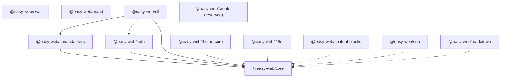
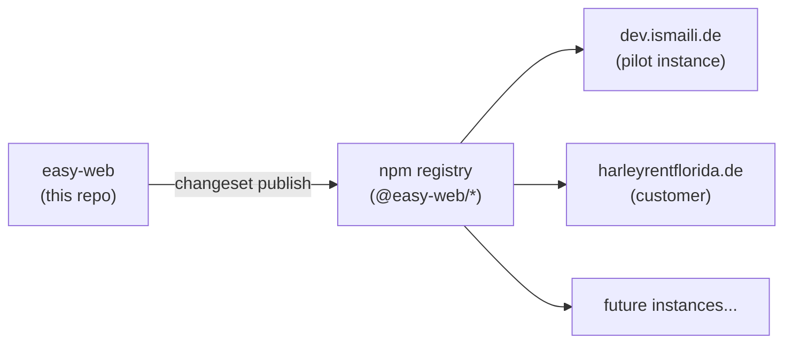

## Monorepo Structure

The easy-web repository is a **pnpm + Turborepo monorepo** publishing one base package, a few add-ons and five compatibility shims, all on one shared version, plus a create-only CLI that is versioned on its own:

```
easy-web/
├── DESIGN.md                            # Design-system contract for the --ew-* tokens and components
├── packages/
│   ├── core/                            # Base: tokens, i18n, SEO, markdown, components, contracts
│   ├── easy-web-cms-adapters/           # Add-on: Decap CMS, typed content definitions
│   ├── easy-web-swa/                    # Add-on: Azure Static Web Apps 404 config
│   ├── auth/                            # Add-on: MSAL.js authentication wrapper
│   ├── easy-web-brand/                  # Add-on: favicon and icon generation
│   ├── easy-web-cli/                    # Tooling: create-only site generator (Node.js 24 or later)
│   ├── create-easy-web/                 # Reserved name, ships no source
│   ├── theme-core/                      # Deprecated shim, re-exports core/theme
│   ├── i18n/                            # Deprecated shim, re-exports core/i18n
│   ├── easy-web-content-blocks/         # Deprecated shim, re-exports core/components
│   ├── seo/                             # Deprecated shim, re-exports core/seo
│   └── easy-web-markdown/               # Deprecated shim, re-exports core/markdown
└── apps/
    ├── docs/                            # This documentation site
    ├── showcase/                        # Live component gallery
    ├── contract-fixture/                # Conformance gate test site
    └── compat-fixture/                  # Proves the compatibility shims still build
```

## Package Dependency Graph



`core` is the base every site installs. `cms-adapters` depends on it for the content contracts and `auth` for the recipe protocol; `swa` and `brand` are independent, and `create` is a reserved name with no code. The CLI depends on core, `auth` and `cms-adapters` because it composes their create recipes, and it never ships inside a site. The dashed edges are the deprecated compatibility packages, which only re-export core and are removed in 2.0.

## The Consumer Pattern

Site instances install easy-web packages from the public npm registry:



**The key benefit**: one package change can benefit every site, but publication does not update a deployed site by itself. Each instance keeps its own manifest and lockfile, accepts an explicit dependency-update PR, runs its own validation pipeline, and deploys its own static artifact. The pilot takes a new family version first; customer updates follow only after that validation succeeds.

## Release Workflow

Releases are automated with [Changesets](https://github.com/changesets/changesets):

1. Contributor runs `pnpm changeset` to describe the change
2. Changesets bot creates a **"Version Packages"** PR when changesets accumulate
3. Merging the PR **publishes all changed packages** to npm via GitHub Actions (OIDC, no stored tokens)

## Package publication and website deployment are separate

The workflows in this repository have independent jobs:

1. **CI** validates the package workspace and builds packed consumers on the recommended and supported toolchain pairings.
2. **Release** publishes npm artifacts after the Changesets version PR is merged. It does not open, merge or deploy a site repository.
3. **Deploy** builds only this repository's showcase and documentation and publishes those static files to GitHub Pages. It does not publish npm packages.

Every pilot or customer website lives in its own repository. A package release becomes a site change only after that repository accepts a dependency and lockfile update, passes its own checks, and runs its own Azure Static Web Apps deployment. This is why a new easy-web release creates an available upgrade rather than an automatic customer rollout.

## Technology Stack

| Layer | Technology |
|-------|-----------|
| Runtime and package manager | Node.js 24 and pnpm 10 (recommended baseline). The packed consumer also proves core, CMS adapters and compatibility packages on Node.js 22 with Astro 6 |
| Build orchestration | Turborepo over pnpm workspaces |
| Language | TypeScript |
| UI framework | Astro 7 components. React only in the `@easy-web/auth` island |
| Authentication | MSAL.js (Microsoft Authentication Library) |
| CMS | Decap CMS (git-based) |
| Testing | Vitest |
| Documentation | Astro Starlight |
| CI/CD | GitHub Actions |
| Releases | Changesets |

Node.js is a build-time requirement: easy-web sites are static output, so Node.js builds a site but is not needed to serve it.

This table is a summary. The [Technology Map](./technology-map/) ties each technology to the package that uses it, the versions it is recommended or supported on, and the lane that validates it.

## Single Auth Island (Important)

All auth-dependent React components on a page **must live inside a single React island**. React Context does not cross Astro island boundaries — two separate `client:*` islands would create two independent MSAL instances.

```astro
<!-- ✅ CORRECT: one island wraps all auth components -->
<AuthProvider client:only="react" config={msalConfig}>
  <UserProfile />
  <LoginButton />
</AuthProvider>

<!-- ❌ WRONG: two islands = two MSAL instances = broken auth -->
<UserProfile client:only="react" />
<LoginButton client:only="react" />
```
