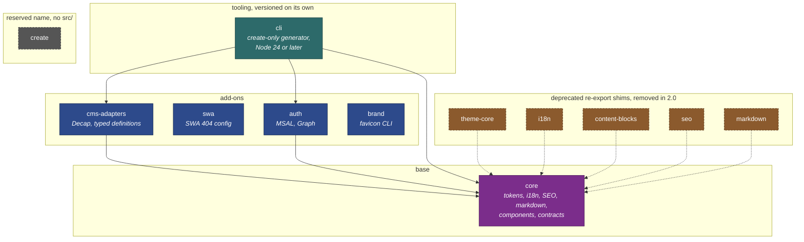
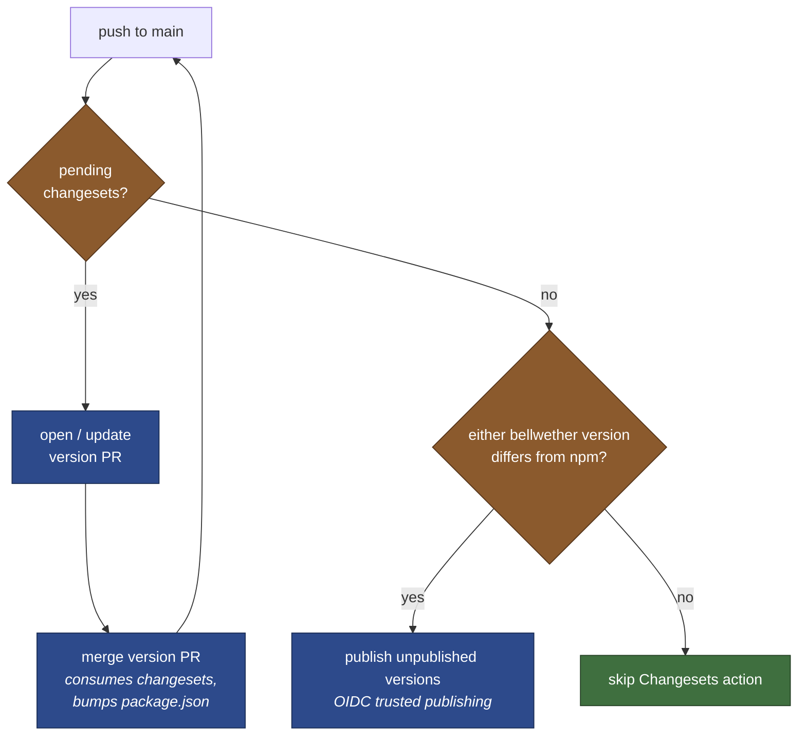
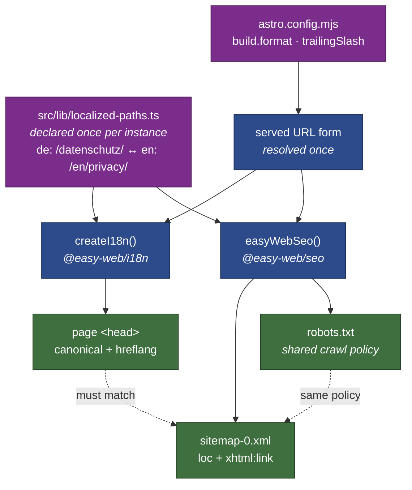

# easy-web Architecture

Visual reference for how the `@easy-web/*` family is wired, released and consumed.
Diagrams are Mermaid and render inline on GitHub.

For reusable guidance on shared-package versus site responsibilities and the
separation between CMS editing and Astro content reading, see the
[Architecture Overview](../apps/docs/src/content/docs/architecture/index.mdx#shared-packages-and-site-responsibilities)
in the documentation site. This file complements that guidance with repository
diagrams.

## Package graph

One base package, four add-ons, a create-only CLI, one reserved name, and five
deprecated compatibility packages (ADR 0018). A site installs `core` and gets a
working site; everything else is opt-in.

`cms-adapters` depends on `core` for the content contracts its definitions are
checked against, and `auth` depends on it for the recipe protocol. `swa` and
`brand` stand alone. The CLI composes the create recipes of `core`, `auth` and
`cms-adapters`; it runs only on the machine that generates a site and never
ships inside one. Each shim is a regular dependency on `core` that re-exports one
subpath with `@deprecated` markers, so existing imports keep working through 1.x.
2.0 removes the shims once every site has migrated.

Host-provided integrations are declared as peers; packages also install regular
third-party dependencies, such as MSAL in auth and Sharp in brand:

| Package | Peer dependencies |
| :--- | :--- |
| `core`, `swa`, `seo`, `markdown` | `astro` |
| `cms-adapters` | `astro`, `sharp` |
| `content-blocks` | `astro`, `zod` |
| `i18n` | `astro`, `@inlang/paraglide-js` |
| `auth` | `astro`, `react`, `react-dom` |
| `theme-core`, `brand` | none |

**Why `core` is a dependency rather than a peer.** Peer-range changes can
propagate breaking bumps through Changesets' fixed group. Core's shared helpers
do not require a host singleton. Auth also depends on core normally, while keeping
React and React DOM as host-provided peers. Peer declarations alone cannot prevent
two MSAL providers: auth-dependent components must share one React island and one
provider. See the [contributing guide](../CONTRIBUTING.md#dependencies-and-host-provided-peers)
for the manifest-backed dependency strategy.

## Propagation: one fix reaches every site

The reason the monorepo exists: a change lands once and becomes available to
every instance through npm. Adoption is explicit, not an automatic rollout.

```mermaid
flowchart LR
  dev["contributor<br/>+ changeset"] --> main["easy-web main"]
  main --> vpr["version PR<br/><i>chore: version packages</i>"]
  vpr -->|merge| release["Release run<br/><i>verify publication</i>"]
  release --> npm[("public npm<br/>fixed family + independent CLI")]
  npm --> update["reviewed site update<br/><i>manifest + lockfile</i>"]
  update --> pilot["pilot<br/><i>validate and deploy</i>"]
  pilot -->|once validated| cust["customer adoption<br/><i>separate checks and deployment</i>"]

  classDef hub fill:#7b2d8b,color:#fff,stroke:#4a1a54
  classDef reg fill:#8b5a2d,color:#fff,stroke:#54341a
  classDef site fill:#2d4a8b,color:#fff,stroke:#1a2d54
  class main,vpr,release hub
  class npm,update reg
  class pilot,cust site
```

All 11 packages in the fixed group share one version (`fixed` grouping), so
"which versions work together?" has a single answer. The CLI is versioned on its
own and is not a generated-site dependency. Pilot-first is a policy, not
a mechanism: the pilot validates a new version before customer adoption.

## Release flow

`changesets/action` opens a version PR when changesets are pending and can publish
when they are not. The workflow admits both paths:

The bellwethers are `@easy-web/i18n` for the fixed family and `@easy-web/cli`
for the independent line. Merging a version PR consumes the changesets, so the
registry comparison keeps the publish path reachable. Neither that comparison
nor the merge proves a complete npm release. See the
[canonical release guidance](../CONTRIBUTING.md#version-pr-publication-and-adoption-are-separate)
for workflow conditions, publication evidence and consumer ownership.

## SEO: one declaration, two surfaces

Canonical URLs, in-page `hreflang` and the sitemap must agree byte-for-byte, or
search engines treat `/x` and `/x/` as competing duplicates and drop mismatched
hreflang clusters. Every emitted URL is therefore derived from one model.

Routes whose slug is identical across locales pair automatically and are not
declared. Only the ones that differ — `/datenschutz/` vs `/en/privacy/` — need
an entry, and a stale entry fails the build rather than degrading silently.

`robots.txt` and the sitemap read the same crawl policy, so a path cannot be
disallowed in one and advertised in the other.

## See also

* [`AGENTS.md`](../AGENTS.md) — repo orientation, workspace layout, publishing workflow
* [`README.md`](../README.md) — package inventory
* Per-package READMEs under [`packages/`](../packages) — the API reference for each `@easy-web/*` package
